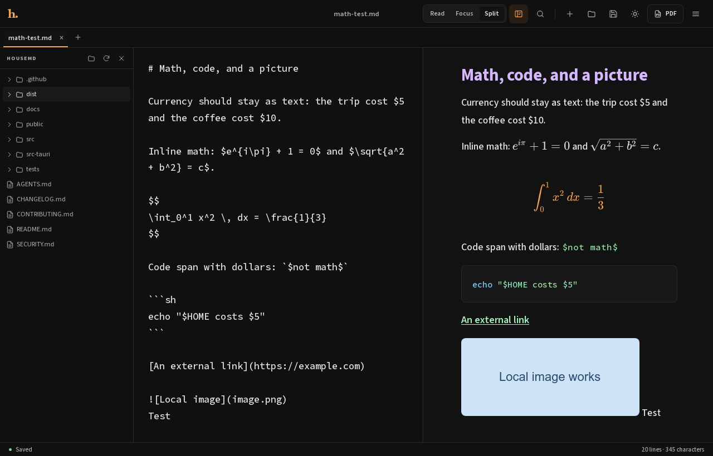
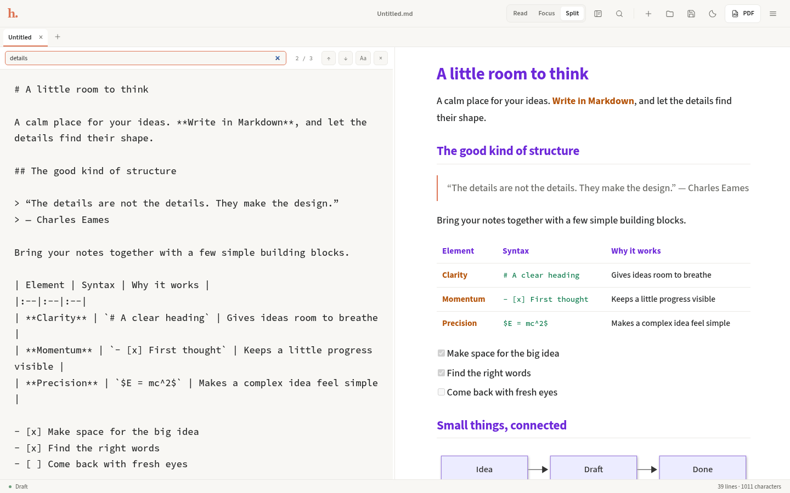
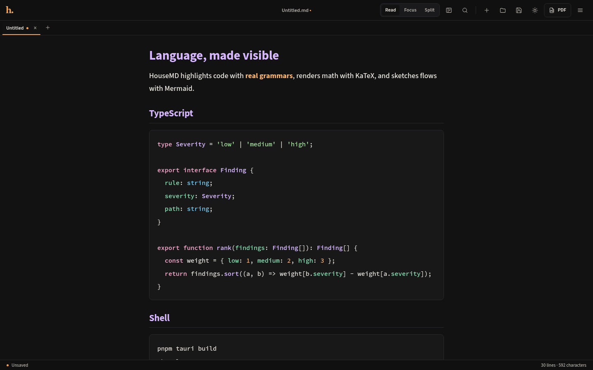
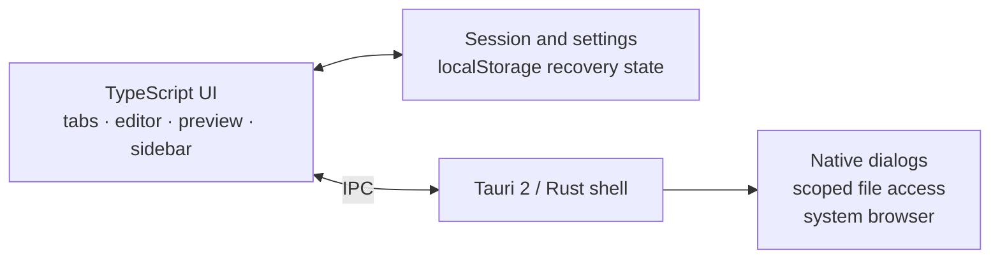

<p align="center">
  
</p>

<h1 align="center">HouseMD</h1>

<p align="center">
  A quiet, local-first Markdown workspace for Linux, macOS, and Windows.
</p>

<p align="center">
  <a href="https://github.com/arnavpadwal/HouseMD/actions/workflows/ci.yml"></a>
  <a href="https://github.com/arnavpadwal/HouseMD/releases"></a>
  <a href="LICENSE"></a>
  
  
  
  <a href="CONTRIBUTING.md"></a>
</p>

<p align="center">
  
</p>

HouseMD is a small desktop Markdown editor with a calm interface and a serious renderer. It opens local files, previews them live, and keeps the tools that matter for technical writing close at hand: real syntax highlighting, KaTeX math, Mermaid diagrams, GitHub-style anchors, sanitized HTML, and relative images.

No account, no sync service, no telemetry. Your notes stay where you put them.

## Why HouseMD?

- **Local by default.** Files are read and written directly through scoped Tauri commands.
- **Tabs that remember.** Open several documents, jump between them, and restore the whole session after a crash.
- **Built for technical notes.** Fenced code is highlighted with highlight.js; math and diagrams are first-class.
- **A preview you can trust.** GitHub-style headings, anchors, tables, task lists, README HTML, and relative images render correctly.
- **A quiet interface.** Three layouts, a large readable type scale, light/dark/system themes, accent colors, and adjustable type sizes.
- **Desktop-native behavior.** Native open/save dialogs, drag-and-drop, file-association/CLI opening, and single-instance handoff.
- **Safe editing.** Unsaved changes are protected, recovery drafts survive a crash, and optional autosave writes changes to disk.

## Screenshots

<table>
  <tr>
    <td width="50%">
      
      <p align="center"><sub><b>Read mode</b> — a comfortable measure for long documents.</sub></p>
    </td>
    <td width="50%">
      
      <p align="center"><sub><b>Folder sidebar</b> — browse a Markdown workspace without leaving the editor.</sub></p>
    </td>
  </tr>
  <tr>
    <td width="50%">
      
      <p align="center"><sub><b>Find and replace</b> — match case, step through results, replace one or all.</sub></p>
    </td>
    <td width="50%">
      
      <p align="center"><sub><b>Settings</b> — theme, accent, type sizes, autosave, and session restore.</sub></p>
    </td>
  </tr>
</table>

<p align="center">
  
</p>

<p align="center"><sub><b>Real syntax highlighting</b> — TypeScript, shell, JSON, Rust, Python, YAML, HTML, CSS, SQL, and more.</sub></p>

## Features

|                             |                                                                                                              |
| :-------------------------- | :----------------------------------------------------------------------------------------------------------- |
| **Tabs and recents**        | Multiple documents, close protection, recent-file menu, and session restore.                                 |
| **Read / Focus / Split**    | Three layouts with an adjustable split divider (mouse, keyboard, or double-click to reset).                  |
| **Live preview**            | Markdown rendered as you type, with per-tab scroll preservation.                                             |
| **Syntax-highlighted code** | highlight.js grammars for TypeScript, JavaScript, shell, JSON, Rust, Python, YAML, HTML, CSS, SQL, and more. |
| **KaTeX math**              | Inline `$…$`, display `$$…$$`, and fenced `math` blocks.                                                     |
| **Mermaid diagrams**        | Flowcharts, sequence diagrams, gantt charts, and the rest of Mermaid at natural size.                        |
| **GitHub-style anchors**    | Heading slugs and empty `<a id="…"></a>` targets work with table-of-contents links.                          |
| **Sanitized HTML**          | Common README markup, images, tables, and anchors render safely; scripts and event handlers are stripped.    |
| **Local images**            | Relative image paths resolve against the open document's folder; HTTPS images are supported.                 |
| **Folder sidebar**          | Open a folder and browse its Markdown files in a collapsible tree.                                           |
| **Find and replace**        | `Ctrl+F` / `Ctrl+H`, match case, next/previous, replace one, or replace all.                                 |
| **Session recovery**        | Tabs, folder, and unsaved recovery drafts are restored after a crash.                                        |
| **Optional autosave**       | Write edits to disk after a short pause when enabled.                                                        |
| **Appearance settings**     | Light / dark / system themes, four accent palettes, and adjustable preview/editor type sizes.                |
| **Native file workflow**    | Open, save, save-as, drag-and-drop, CLI/desktop file opening, and single-instance reuse.                     |
| **Print / PDF**             | Print dialog with a clean print stylesheet for the rendered preview.                                         |

## Installation

### Prebuilt release

Download the latest bundle from [Releases](https://github.com/arnavpadwal/HouseMD/releases).

**Debian / Ubuntu**

```sh
sudo apt install ./HouseMD_2.0.0_amd64.deb
```

**Fedora / RHEL**

```sh
sudo dnf install ./HouseMD-2.0.0-1.x86_64.rpm
```

**Arch Linux / other distributions**

Use the AppImage:

```sh
chmod +x HouseMD_2.0.0_amd64.AppImage
./HouseMD_2.0.0_amd64.AppImage
```

For desktop-menu integration, use an AppImage manager such as Gear Lever, or build from source and install the binary and `.desktop` entry into `~/.local`.

> v2.0.0 ships Linux bundles. macOS and Windows builds can be produced from source with Tauri; signed installers require platform signing credentials and are tracked on the roadmap.

### Build from source

**Prerequisites**

- Rust stable
- Node.js 22.6+
- pnpm 10+
- Tauri system dependencies ([Linux](https://v2.tauri.app/start/prerequisites/), macOS, or Windows)

```sh
git clone https://github.com/arnavpadwal/HouseMD.git
cd HouseMD
pnpm install
pnpm tauri dev
```

Create a distributable for the current platform:

```sh
pnpm tauri build
```

## Usage

Open a document from the toolbar, drag a Markdown file onto the window, use the folder sidebar, or pass a file on the command line:

```sh
housemd notes.md
```

A second launch with another file reuses the existing window and opens a tab.

### Keyboard shortcuts

| Action                     | Shortcut                      |
| :------------------------- | :---------------------------- |
| New tab                    | `Ctrl+N` / `⌘N`               |
| Close tab                  | `Ctrl+W` / `⌘W`               |
| Next / previous tab        | `Ctrl+Tab` / `Ctrl+Shift+Tab` |
| Open                       | `Ctrl+O` / `⌘O`               |
| Save                       | `Ctrl+S` / `⌘S`               |
| Save as                    | `Ctrl+Shift+S` / `⌘⇧S`        |
| Find                       | `Ctrl+F` / `⌘F`               |
| Replace                    | `Ctrl+H` / `⌘H`               |
| Toggle folder sidebar      | `Ctrl+B` / `⌘B`               |
| Settings                   | `Ctrl+,` / `⌘,`               |
| Print / PDF                | `Ctrl+P` / `⌘P`               |
| Markdown guide             | `Ctrl+/` / `⌘/`               |
| Close guide, find, or menu | `Esc`                         |

### Markdown support

- CommonMark, GFM tables and task lists
- Fenced code with language-aware highlighting
- Inline and display math with KaTeX
- Mermaid diagrams in `mermaid` fences
- Relative image paths, HTTPS images, and external links
- GitHub-style heading IDs and explicit anchors
- Sanitized inline HTML for README-style layouts, images, and tables

## Architecture



- **Frontend:** framework-free TypeScript, Vite, and a sectioned stylesheet.
- **Renderer:** `src/markdown.ts` — markdown-it, highlight.js, KaTeX, Mermaid, sanitized HTML, anchors, and heading IDs.
- **State:** `src/model.ts` — tabs, settings, recents, and session persistence.
- **Shell:** `src-tauri/src/lib.rs` — Tauri plugins, scoped asset/file access, CLI file opening, and single-instance handoff.
- **Tests:** Node's test runner against the pure renderer and path helpers.

```text
src/
  content.ts       sample document, icons, Markdown guide entries
  explorer.ts      folder tree state and rendering
  findbar.ts       find/replace controller
  main.ts          app shell, tabs, file lifecycle, menus, shortcuts
  markdown.ts      Markdown/KaTeX/Mermaid/highlight.js/sanitizer renderer
  model.ts         tabs, settings, recents, session storage
  paths.ts         cross-platform path helpers
  settings-panel.ts appearance and file behavior dialog
  style.css        tokens, layout, Markdown, tabs, sidebar, overlays, print
  vendor.d.ts      ambient declarations for untyped dependencies
tests/
  markdown.test.ts
  paths.test.ts
src-tauri/
  src/lib.rs      Tauri setup and native commands
  capabilities/   permission scopes
  tauri.conf.json window, CSP, asset protocol, bundles
```

## Development

```sh
pnpm install
pnpm tauri dev      # desktop app with Vite
pnpm check          # typecheck + 16 tests + Prettier check
pnpm build          # frontend production build
pnpm tauri build    # desktop bundles
```

Useful individual commands:

```sh
pnpm typecheck
pnpm test
pnpm format
cargo fmt --manifest-path src-tauri/Cargo.toml
cargo clippy --manifest-path src-tauri/Cargo.toml --all-targets -- -D warnings
```

### Branches

| Branch      | Purpose                                       |
| :---------- | :-------------------------------------------- |
| `main`      | Stable, released code                         |
| `develop`   | Integration branch for the next release       |
| `feature/*` | Focused changes, opened as PRs into `develop` |

## Roadmap

- [x] v1.0.0 — renderer, themes, file workflow, single instance
- [x] v2.0.0 — tabs, recent files, session recovery, autosave, find/replace, settings, folder sidebar
- [ ] Signed and notarized macOS installers
- [ ] Signed Windows installers
- [ ] File operations in the sidebar (rename, delete, new file)
- [ ] Split-pane scroll synchronization
- [ ] User-provided custom themes

Have an idea? [Open an issue](https://github.com/arnavpadwal/HouseMD/issues).

## Contributing

Contributions are welcome. Read [CONTRIBUTING.md](CONTRIBUTING.md) for setup, branch, and review guidance. Please open PRs against `develop`.

## License

HouseMD is released under the [MIT License](LICENSE).

Bundled fonts are licensed under the SIL Open Font License; see [`public/licenses`](public/licenses). Third-party libraries retain their own licenses.

## Acknowledgements

Built with [Tauri](https://tauri.app), [markdown-it](https://github.com/markdown-it/markdown-it), [highlight.js](https://highlightjs.org), [KaTeX](https://katex.org), and [Mermaid](https://mermaid.js.org). Type set in [Source Sans 3](https://adobe-fonts.github.io/source-sans/) and [Source Code Pro](https://adobe-fonts.github.io/source-code-pro/).
