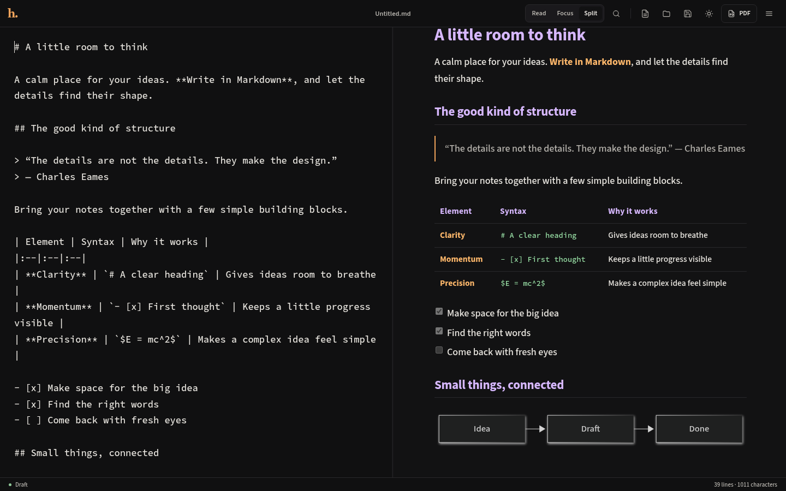
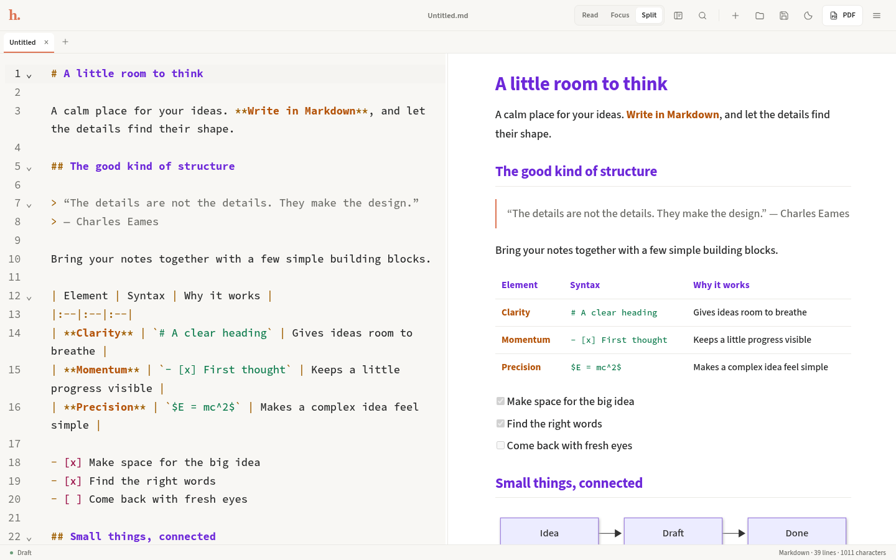
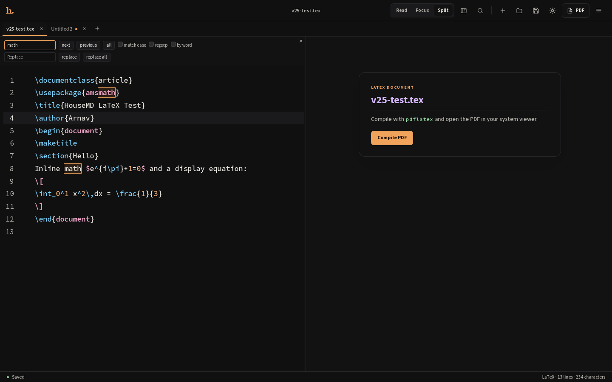
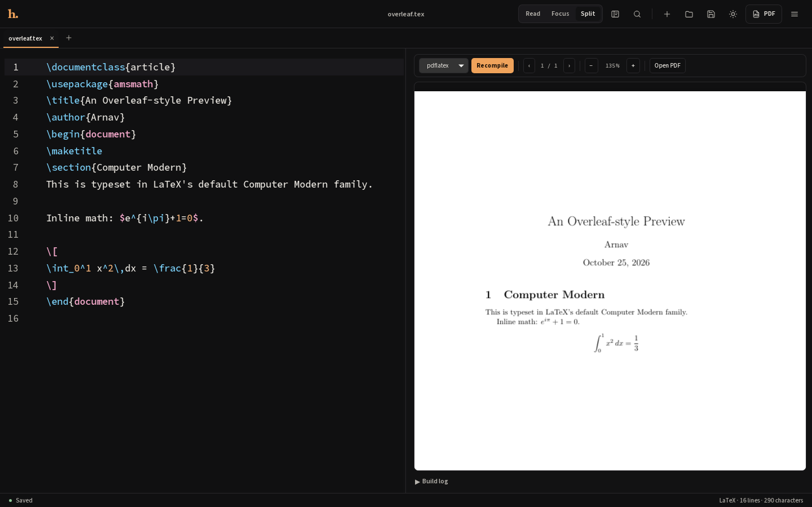
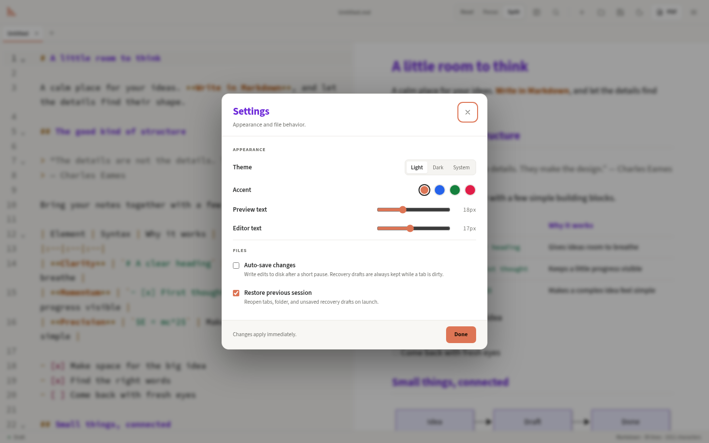
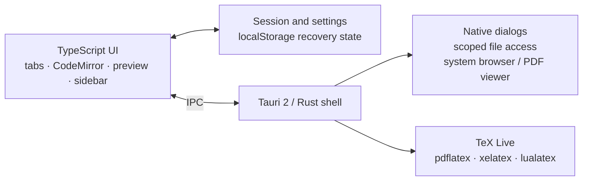

<p align="center">
  
</p>

<h1 align="center">HouseMD</h1>

<p align="center">
  A quiet, local-first Markdown and LaTeX workspace for Linux, macOS, and Windows.
</p>

<p align="center">
  <a href="https://github.com/arnavpadwal/HouseMD/actions/workflows/ci.yml"></a>
  <a href="https://github.com/arnavpadwal/HouseMD/releases"></a>
  <a href="LICENSE"></a>
  
  
  
  
  
  <a href="CONTRIBUTING.md"></a>
</p>

<p align="center">
  
</p>

HouseMD is a small desktop editor for Markdown, LaTeX, and plain text. It combines a CodeMirror 6 editor with a serious Markdown/KaTeX/Mermaid renderer and a real LaTeX compile workflow — without accounts, sync services, or telemetry.

Write Markdown on the left and see the rendered result on the right. Open a `.tex` file, get LaTeX syntax highlighting and line numbers, and compile it to a PDF with the TeX Live installation you already trust.

## Why HouseMD?

- **One editor for Markdown, LaTeX, and text.** Tabs, recents, session recovery, and syntax highlighting in one local app.
- **A real code editor.** CodeMirror 6 brings line numbers, folding, search and replace, multiple cursors, and VS Code-style commands.
- **Change all occurrences.** Select every match of the current word with `Ctrl+Shift+L`, then type the replacement once.
- **A preview you can trust.** GitHub-style headings, anchors, tables, task lists, sanitized README HTML, relative images, KaTeX, and Mermaid.
- **LaTeX that compiles.** Use your system `pdflatex`, `xelatex`, or `lualatex`; the generated PDF opens in your system viewer.
- **Local and quiet.** Scoped file access, no telemetry, and light/dark/system themes with accent palettes and adjustable type sizes.
- **Safe editing.** Unsaved changes are protected, recovery drafts survive a crash, and optional autosave writes changes to disk.

## Screenshots

<table>
  <tr>
    <td width="50%">
      
      <p align="center"><sub><b>Line numbers and live preview</b> — Markdown highlighted in the editor, rendered on the right.</sub></p>
    </td>
    <td width="50%">
      
      <p align="center"><sub><b>Find and replace</b> — match case, regexp, whole word, replace one or all.</sub></p>
    </td>
  </tr>
  <tr>
    <td width="50%">
      
      <p align="center"><sub><b>LaTeX workspace</b> — syntax highlighting, line numbers, and one-click PDF compilation.</sub></p>
    </td>
    <td width="50%">
      
      <p align="center"><sub><b>Settings</b> — theme, accent, type sizes, autosave, and session restore.</sub></p>
    </td>
  </tr>
</table>

## Features

|                            |                                                                                                                    |
| :------------------------- | :----------------------------------------------------------------------------------------------------------------- |
| **CodeMirror 6 editor**    | Line numbers, code folding, bracket matching, active-line highlighting, undo history, and multiple cursors.        |
| **Language-aware editing** | Markdown, LaTeX, and plain text highlighting selected from the file extension.                                     |
| **Find and replace**       | `Ctrl+F` / `Ctrl+H` with case, regexp, whole-word, next/previous, replace, and replace all.                        |
| **Change all occurrences** | `Ctrl+Shift+L` (or `Ctrl+F2`) selects every match for multi-cursor editing.                                        |
| **Go to line**             | `Ctrl+G` opens the CodeMirror line prompt.                                                                         |
| **LaTeX support**          | `.tex` / `.latex` editing, `.sty` / `.cls` highlighting, and compilation via `pdflatex`, `xelatex`, or `lualatex`. |
| **Tabs and recents**       | Multiple documents, close protection, recent-file menu, and full session restore.                                  |
| **Read / Focus / Split**   | Three layouts with an adjustable split divider (mouse, keyboard, or double-click to reset).                        |
| **Live Markdown preview**  | Tables, task lists, blockquotes, sanitized HTML, and per-tab scroll preservation.                                  |
| **KaTeX math**             | Inline `$…$`, display `$$…$$`, and fenced `math` blocks.                                                           |
| **Mermaid diagrams**       | Flowcharts, sequence diagrams, gantt charts, and the rest of Mermaid at natural size.                              |
| **GitHub-style anchors**   | Heading slugs and empty `<a id="…"></a>` targets work with table-of-contents links.                                |
| **Local images**           | Relative image paths resolve against the open document's folder; HTTPS images are supported.                       |
| **Folder sidebar**         | Open a folder and browse its Markdown, LaTeX, and text files in a collapsible tree.                                |
| **Session recovery**       | Tabs, folder, and unsaved recovery drafts are restored after a crash.                                              |
| **Optional autosave**      | Write edits to disk after a short pause when enabled.                                                              |
| **Appearance settings**    | Light / dark / system themes, four accent palettes, and adjustable preview/editor type sizes.                      |
| **Native file workflow**   | Open, save, save-as, drag-and-drop, CLI/desktop file opening, and single-instance reuse.                           |
| **Print / PDF**            | Print dialog with a clean print stylesheet for the rendered Markdown preview.                                      |

## Installation

### Prebuilt release

Download the latest bundle from [Releases](https://github.com/arnavpadwal/HouseMD/releases).

### Flatpak (recommended on Linux)

```sh
flatpak remote-add --user --if-not-exists flathub https://flathub.org/repo/flathub.flatpakrepo
flatpak install --user ./HouseMD-2.5.0-x86_64.flatpak
flatpak run com.housemd.markdown
```

The Flatpak uses the GNOME 51 runtime (which includes WebKitGTK 4.1), has access to your home directory, and can use your host TeX Live installation for LaTeX compilation. The app appears in your desktop launcher after installation.

**Debian / Ubuntu**

```sh
sudo apt install ./HouseMD_2.5.0_amd64.deb
```

**Fedora / RHEL**

```sh
sudo dnf install ./HouseMD-2.5.0-1.x86_64.rpm
```

**Arch Linux / other distributions**

Use the AppImage:

```sh
chmod +x HouseMD_2.5.0_amd64.AppImage
./HouseMD_2.5.0_amd64.AppImage
```

For desktop-menu integration, use an AppImage manager such as Gear Lever, or build from source and install the binary and `.desktop` entry into `~/.local`.

> v2.5.0 ships Flatpak, Debian, Fedora/RHEL, and AppImage bundles. macOS and Windows builds can be produced from source with Tauri; signed installers require platform signing credentials and are tracked on the roadmap.

### LaTeX requirements

LaTeX editing and highlighting work without a TeX installation. Compilation requires one of:

```sh
pdflatex --version
xelatex --version
lualatex --version
```

Install TeX Live (or MacTeX / MiKTeX) to enable **Compile PDF**. The app runs the compiler in the document's folder with shell escape disabled and opens the generated PDF with your system PDF viewer.

In the Flatpak build, the compiler wrappers call your **host** TeX installation through `flatpak-spawn`. If TeX is not installed on the host, the LaTeX panel reports that no compiler was found.

### Build from source

**Prerequisites**

- Rust stable
- Node.js 22.6+
- pnpm 10+
- Tauri system dependencies ([Linux](https://v2.tauri.app/start/prerequisites/), macOS, or Windows)
- Optional: TeX Live for LaTeX compilation

```sh
git clone https://github.com/arnavpadwal/HouseMD.git
cd HouseMD
pnpm install
pnpm tauri dev
```

Create a distributable for the current platform:

```sh
pnpm tauri build
```

## Usage

Open a document from the toolbar, drag a file onto the window, use the folder sidebar, or pass a file on the command line:

```sh
housemd notes.md
housemd paper.tex
housemd references.bib
```

A second launch with another file reuses the existing window and opens a tab.

### Keyboard shortcuts

| Action                     | Shortcut                      |
| :------------------------- | :---------------------------- |
| New tab                    | `Ctrl+N` / `⌘N`               |
| Close tab                  | `Ctrl+W` / `⌘W`               |
| Next / previous tab        | `Ctrl+Tab` / `Ctrl+Shift+Tab` |
| Open                       | `Ctrl+O` / `⌘O`               |
| Save                       | `Ctrl+S` / `⌘S`               |
| Save as                    | `Ctrl+Shift+S` / `⌘⇧S`        |
| Find                       | `Ctrl+F` / `⌘F`               |
| Replace                    | `Ctrl+H` / `⌘H`               |
| Change all occurrences     | `Ctrl+Shift+L` or `Ctrl+F2`   |
| Go to line                 | `Ctrl+G` / `⌘G`               |
| Select next occurrence     | `Ctrl+D` / `⌘D`               |
| Toggle folder sidebar      | `Ctrl+B` / `⌘B`               |
| Settings                   | `Ctrl+,` / `⌘,`               |
| Print / PDF                | `Ctrl+P` / `⌘P`               |
| Markdown / LaTeX guide     | `Ctrl+/` / `⌘/`               |
| Close guide, find, or menu | `Esc`                         |

### Supported files

| Kind                | Extensions                   |
| :------------------ | :--------------------------- |
| Markdown            | `.md`, `.markdown`, `.mdown` |
| LaTeX documents     | `.tex`, `.latex`             |
| LaTeX support files | `.sty`, `.cls`               |
| Bibliography        | `.bib`                       |
| Plain text          | `.txt`                       |

### Markdown and LaTeX rendering

**Markdown**

- CommonMark, GFM tables and task lists
- Fenced code with language-aware highlighting
- Inline and display math with KaTeX
- Mermaid diagrams in `mermaid` fences
- Relative and HTTPS images, external links
- GitHub-style heading IDs and explicit anchors
- Sanitized inline HTML for README-style layouts

**LaTeX**

- Syntax highlighting and folding through CodeMirror's LaTeX mode
- Line numbers, search/replace, and multi-cursor editing
- Compile with `pdflatex`, `xelatex`, or `lualatex`
- Build log in the preview panel; generated PDF opened in the system viewer
- Compiler runs with `-no-shell-escape` for safer local builds

## Architecture



- **Editor:** `src/editor.ts` — CodeMirror 6, language detection, search, multi-cursor, line numbers.
- **Renderer:** `src/markdown.ts` — markdown-it, highlight.js, KaTeX, Mermaid, sanitized HTML, anchors.
- **State:** `src/model.ts` — tabs, settings, recents, and session persistence.
- **LaTeX build:** `src-tauri/src/lib.rs` — compiler detection, sandboxed build flags, PDF path.
- **Tests:** Node's test runner against the renderer and path helpers.

```text
src/
  content.ts       sample document, icons, Markdown/LaTeX guides
  editor.ts        CodeMirror 6 editor and language configuration
  explorer.ts      folder tree state and rendering
  main.ts          app shell, tabs, file lifecycle, menus, shortcuts
  markdown.ts      Markdown/KaTeX/Mermaid/highlight.js/sanitizer renderer
  model.ts         tabs, settings, recents, session storage
  paths.ts         cross-platform path and file-kind helpers
  settings-panel.ts appearance and file behavior dialog
  style.css        tokens, layout, editor, preview, overlays, print
  vendor.d.ts      ambient declarations for untyped dependencies
tests/
  markdown.test.ts
  paths.test.ts
src-tauri/
  src/lib.rs      Tauri setup, scoped access, LaTeX compile command
  capabilities/   permission scopes
  tauri.conf.json window, CSP, asset protocol, bundles
flatpak/
  com.housemd.markdown.yml  Flatpak manifest
  build-flatpak.sh          local Flatpak bundle builder
  wrappers                   host TeX wrappers
```

## Development

```sh
pnpm install
pnpm tauri dev      # desktop app with Vite
pnpm check          # typecheck + 18 tests + Prettier check
pnpm build          # frontend production build
pnpm tauri build    # desktop bundles
```

Useful individual commands:

```sh
pnpm typecheck
pnpm test
pnpm format
cargo fmt --manifest-path src-tauri/Cargo.toml
cargo clippy --manifest-path src-tauri/Cargo.toml --all-targets -- -D warnings
```

### Branches

| Branch      | Purpose                                       |
| :---------- | :-------------------------------------------- |
| `main`      | Stable, released code                         |
| `develop`   | Integration branch for the next release       |
| `feature/*` | Focused changes, opened as PRs into `develop` |

## Roadmap

- [x] v1.0.0 — renderer, themes, file workflow, single instance
- [x] v2.0.0 — tabs, recovery, autosave, find/replace, settings, folder sidebar
- [x] v2.5.0 — CodeMirror editor, line numbers, multi-cursor/change-all, LaTeX editing and compilation
- [x] v2.5.0 Flatpak bundle with host TeX support
- [ ] Signed and notarized macOS installers
- [ ] Signed Windows installers
- [ ] LaTeX project/bibliography compilation (`bibtex` / `biber`)
- [ ] File operations in the sidebar (rename, delete, new file)
- [ ] Split-pane scroll synchronization

Have an idea? [Open an issue](https://github.com/arnavpadwal/HouseMD/issues).

## Contributing

Contributions are welcome. Read [CONTRIBUTING.md](CONTRIBUTING.md) for setup, branch, and review guidance. Please open PRs against `develop`.

## License

HouseMD is released under the [MIT License](LICENSE).

Bundled fonts are licensed under the SIL Open Font License; see [`public/licenses`](public/licenses). Third-party libraries retain their own licenses.

## Acknowledgements

Built with [Tauri](https://tauri.app), [CodeMirror](https://codemirror.net), [markdown-it](https://github.com/markdown-it/markdown-it), [highlight.js](https://highlightjs.org), [KaTeX](https://katex.org), and [Mermaid](https://mermaid.js.org). Type set in [Source Sans 3](https://adobe-fonts.github.io/source-sans/) and [Source Code Pro](https://adobe-fonts.github.io/source-code-pro/).
